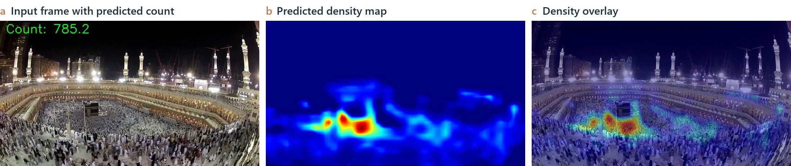
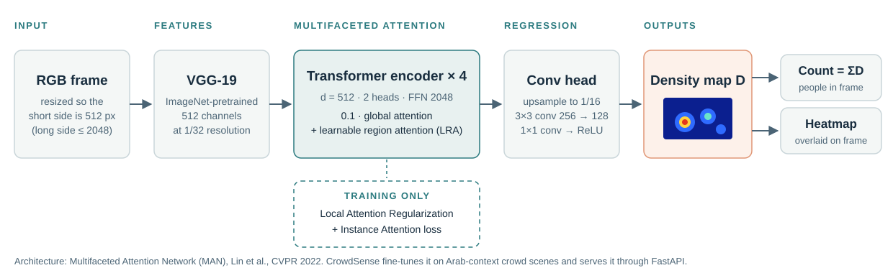
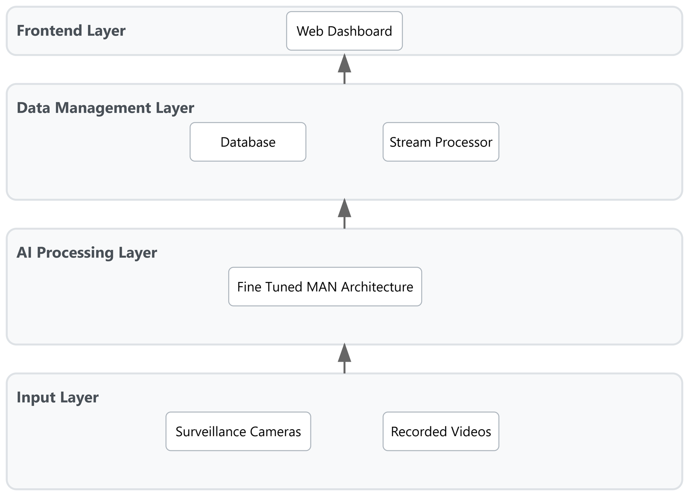
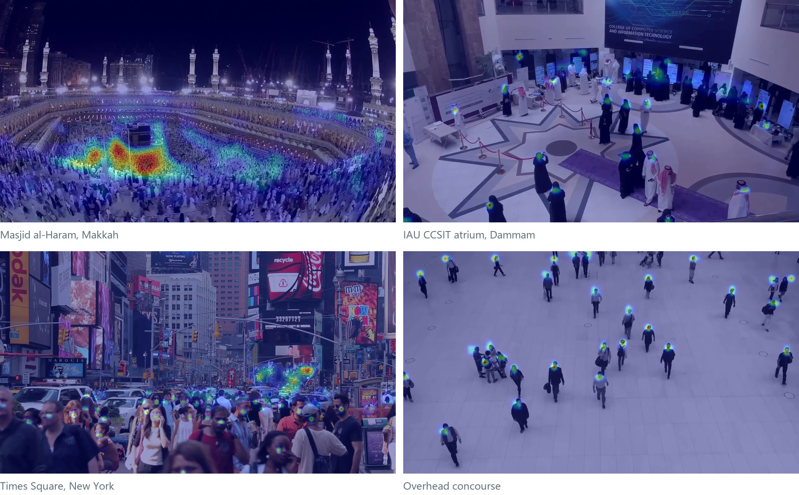
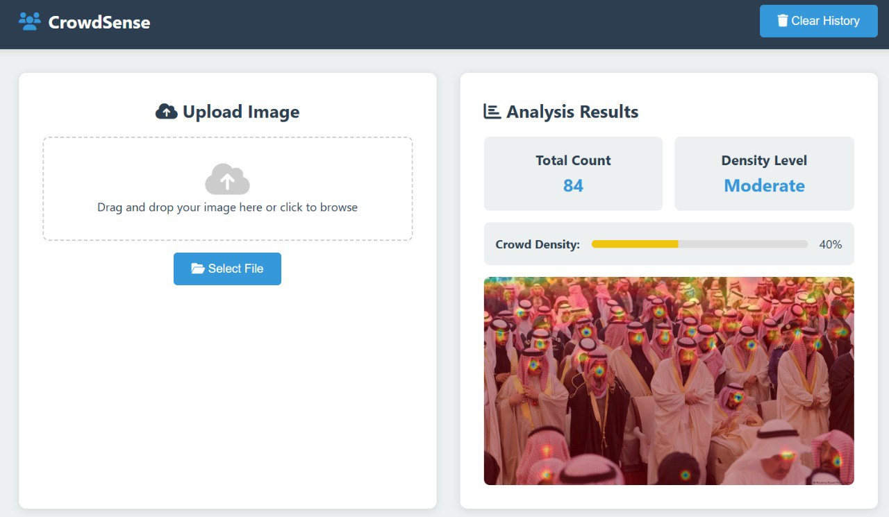
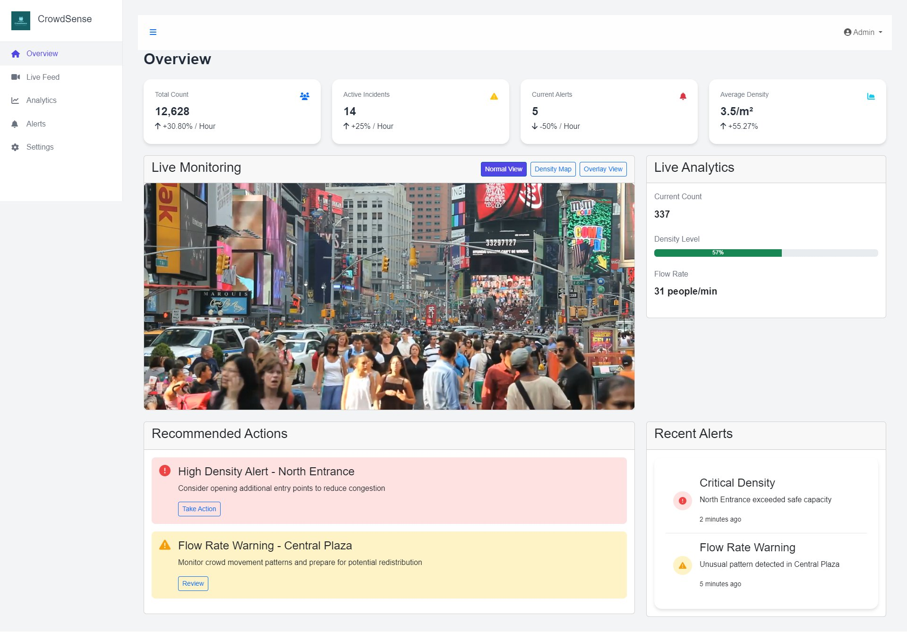

<h1 align="center">CrowdSense: Real-Time Crowd Density Estimation and Monitoring with Multifaceted Attention</h1>

<p align="center">
  <b>Rayan Al-Masad</b> &nbsp;
  <b><a href="https://safwanx.github.io/">Safwan Nabeel</a></b> &nbsp;
  <b>Basel Alabdullah</b> &nbsp;
  <b>Abdulrahman Aldubayyan</b> &nbsp;
  <b>Amr Alanazi</b>
</p>

<p align="center">
  Supervised by <b>Mr. Sardar Zafar Iqbal</b>
</p>

<p align="center">
  Department of Computer Information Systems, College of Computer Science &amp; Information Technology<br>
  Imam Abdulrahman Bin Faisal University, Dammam, Saudi Arabia
</p>

<p align="center"><b>B.Sc. Senior Project · May 2025</b> &nbsp;·&nbsp; Submitted to the ISA Saudi Automation Conference (ISASC) 2025</p>

<p align="center">
  <a href="#quick-start"><strong>Quick Start</strong></a> &nbsp;•&nbsp;
  <a href="#results"><strong>Results</strong></a> &nbsp;•&nbsp;
  <a href="#citation"><strong>Citation</strong></a>
</p>

<p align="center">
  <a href="https://github.com/safwanx/CrowdSense"></a>
  
  
  
  
  <a href="LICENSE"></a>
</p>

<p align="center">
  
</p>
<p align="center">
  <sub>One frame from Masjid al-Haram, Makkah. CrowdSense regresses a density map (b) whose sum is the crowd count shown in (a); the overlay (c) is what operators see on the dashboard. The model is never told where individual people are at inference time.</sub>
</p>

---

## News

- **2025-10:** Code and demo media released.
- **2025-05:** Submitted to the ISA Saudi Automation Conference (ISASC) 2025, Al Khobar.
- **2025-05:** Senior project completed at Imam Abdulrahman Bin Faisal University.

## Abstract

Saudi Arabia is preparing to host millions of visitors at the Hajj, Riyadh Season, the Asian Cup 2027, and Expo 2030, while manual CCTV monitoring is limited by human attention and reaction time. CrowdSense is a real-time crowd monitoring system that estimates crowd counts and density maps from camera footage, visualizes them on a web dashboard, and raises threshold-based alerts. It builds on the Multifaceted Attention Network (MAN), which combines global transformer attention with learnable region attention to cope with the large scale variation in crowd scenes. Because public benchmarks contain few scenes with traditional Arab attire such as thobes, shemaghs, hijabs, and niqabs, we fine-tuned the model on a custom Arab-context set of 400 annotated images from Hajj gatherings and local festivals, augmented to 2,000. Adaptation reduced counting MAE on Arab-context scenes from 87.3 to 62.8 (28.1%). In system testing, the deployed pipeline reached 87% count accuracy against manual counts, triggered alerts in 2.1 s, and processed a single stream in 0.8 s; with ten concurrent streams, processing time exceeded the 2 s target.

## Key Contributions

- **Arab-context adaptation.** A culturally specific annotated crowd set and a fine-tuned MAN model that lowers counting error on Saudi scenes by 28.1% MAE.
- **End-to-end system.** A FastAPI inference service returning counts and heatmap overlays, an image-upload analysis tool, and a monitoring dashboard with normal, density-map, and overlay views.
- **Annotation tooling.** A viewer and an editor for `.mat` head-point annotations, with click-to-add, delete, undo, and redo.
- **Tested against requirements.** A system test plan and report covering accuracy, latency, alerting, and load, with the failures and open issues stated.

## Table of Contents

[Method Overview](#method-overview) &nbsp;|&nbsp; [Quick Start](#quick-start) &nbsp;|&nbsp; [Results](#results) &nbsp;|&nbsp; [Interface](#interface) &nbsp;|&nbsp; [API](#api) &nbsp;|&nbsp; [Repository Structure](#repository-structure) &nbsp;|&nbsp; [Team](#team) &nbsp;|&nbsp; [Citation](#citation)

---

## Method Overview

<p align="center">
  
</p>
<p align="center">
  <sub>Inference pipeline, as implemented in <a href="backend/models/"><code>backend/models/</code></a> and <a href="backend/main.py"><code>backend/main.py</code></a>. The count is the integral of the predicted density map; no person detector is involved.</sub>
</p>

**Why density estimation.** In scenes such as the Haram, people occlude each other so heavily that detecting individuals fails. Density regression predicts how many people occupy each region instead, so the count stays meaningful when nobody is fully visible.

**Multifaceted attention.** CrowdSense uses the MAN architecture of [Lin et al. (CVPR 2022)](https://arxiv.org/abs/2203.02636):

| Component | Role | When |
| :--- | :--- | :--- |
| Learnable Region Attention (LRA) | Learns, per feature location, how large a neighbourhood to attend to, so near (large) and far (small) heads are both handled | Training and inference |
| Global attention | Standard transformer attention over all locations, weighted 0.1 and added to the local term | Training and inference |
| Local Attention Regularization (LAR) | Encourages similar attention for objects of similar real size | Training only |
| Instance Attention | Down-weights noisy head annotations during training | Training only |

**System architecture.** The deployed system has four layers: cameras or recorded video (input), the fine-tuned MAN model (AI processing), a database and stream processor (data management), and the web dashboard (frontend).

<details>
<summary><b>System architecture diagram</b></summary>
<br>
<p align="center"></p>
</details>

## Quick Start

With Python 3.9 or newer, from the repository root:

```bash
pip install -r backend/requirements.txt
```

Put a checkpoint at `backend/weights/model.pth`, or set `CROWDSENSE_WEIGHTS` to its path. Weights are not stored in this repository; see [backend/weights/README.md](backend/weights/README.md). Then start the API:

```bash
cd backend
python -m uvicorn main:app
```

The first start downloads the ImageNet VGG-19 weights through torchvision. Once the log shows `Model loaded successfully`, open [`frontend.html`](frontend.html) in a browser and drop in a crowd image. It calls `http://localhost:8000/predict/` and shows the count, a density level, and the heatmap overlay.

**Dashboard demo, no backend needed.** Open [`HTML & CSS/index.html`](HTML%20%26%20CSS/index.html) in a browser. The dashboard plays pre-rendered model outputs from [`media/`](media/) in normal, density, and overlay views for three sites: Times Square ([`dashboard.html`](HTML%20%26%20CSS/dashboard.html)), IAU ([`dashboard-iau.html`](HTML%20%26%20CSS/dashboard-iau.html)), and Makkah ([`dashboard-makkah.html`](HTML%20%26%20CSS/dashboard-makkah.html)).

**Annotation tools.** [`Misc/display_pt.py`](Misc/display_pt.py) shows head-point annotations on an image, and [`Misc/annotation_adv.py`](Misc/annotation_adv.py) edits them (add, remove, undo, redo, save). Both open a file picker and expect images in an `images/` folder with `.mat` files of the same base name, each holding a `points` array, in a sibling `annotations/` folder.

## Results

### Arab-context adaptation

Counting error on the held-out Arab-context scenes, before and after fine-tuning MAN on the custom set. Lower is better.

| Model | MAE | MSE |
| :--- | ---: | ---: |
| MAN, before adaptation | 87.3 | 134.5 |
| MAN, fine-tuned on Arab-context set | **62.8** | **98.2** |
| Relative reduction | 28.1% | 27.0% |

The set has 400 annotated images from Hajj gatherings and local festivals, expanded to 2,000 with augmentation. It is not distributed, so these numbers cannot be reproduced from this repository.

### Reference: MAN on public benchmarks

CrowdSense deploys MAN rather than proposing a new counting architecture. For context, these are the results reported for MAN by [Lin et al. (2022)](https://arxiv.org/abs/2203.02636), with the relative improvement over the Bayesian Loss (BL) baseline. They are not CrowdSense measurements.

| Dataset | MAE | MSE | MAE vs. BL | MSE vs. BL |
| :--- | ---: | ---: | ---: | ---: |
| ShanghaiTech A | 56.8 | 90.3 | −9.6% | −11.3% |
| UCF-QNRF | 77.3 | 131.5 | −12.9% | −15.1% |
| JHU-Crowd++ | 53.4 | 209.9 | −28.8% | −30.0% |
| NWPU-Crowd | 76.5 | 323.0 | −27.4% | −28.9% |

### System testing

System testing ran from 16 February to 5 April 2025 against the requirements in the project's SRS. Count accuracy is the agreement between the predicted count and a manual count on test video feeds.

| Measurement | Result | Requirement | Status |
| :--- | ---: | ---: | :--- |
| Count accuracy, average | 87% | ≥ 85% | Pass |
| Count accuracy, low / medium / high density | 87% / 86% / 85% | ≥ 85% | Pass |
| Single-stream processing time | 0.8 s | – | – |
| Five concurrent streams | 1.9 s | ≤ 2 s | Pass |
| Ten concurrent streams | 2.3 s | ≤ 2 s | **Fail** |
| End-to-end pipeline latency, average | 4.2 s | ≤ 5 s | Pass |
| Alert trigger response | 2.1 s | ≤ 3 s | Pass |
| Dashboard render | 1.7 s | ≤ 2 s | Pass |

Of all test cases, 78% passed, 12% passed with minor issues, 5% failed, and 5% could not be completed on the available hardware. Testing logged 23 issues: none critical, 3 high, 8 medium, 7 low, and 5 enhancement requests.

### Across scenes

<p align="center">
  
</p>
<p align="center">
  <sub>The same model on four very different scenes: extreme density with perspective distortion (Makkah), sparse indoor groups in traditional attire (IAU), mixed near and far pedestrians (Times Square), and a top-down view (concourse). Each frame is from the clips in <a href="media/"><code>media/</code></a>.</sub>
</p>

### Reading these results

- The Arab-context set is small and was collected and annotated by the team; results on other Saudi venues, camera heights, or lighting conditions were not measured.
- The benchmark table above reproduces published MAN numbers for context; this repository does not re-evaluate MAN on those datasets.
- Latency and load figures come from the team's test environment. Full-scale load testing at Hajj-like volumes was not possible with the available hardware, and performance degraded beyond 10 streams or 100 concurrent users.
- In the dashboard demo, the summary statistics, alerts, and flow rate are simulated in JavaScript; only the video views come from the model.

## Interface

<table>
  <tr>
    <td width="40%" valign="top">
      
      <br><sub><b>Image analysis</b> (<code>frontend.html</code>). Upload an image; the API returns the count and a heatmap overlay. Here, a gathering in traditional Saudi attire is counted at 84.</sub>
    </td>
    <td width="60%" valign="top">
      
      <br><sub><b>Monitoring dashboard</b> (<code>HTML &amp; CSS/dashboard.html</code>). Live feed with three view modes, analytics, recommended actions, and severity-coded alerts.</sub>
    </td>
  </tr>
</table>

## API

The backend is a FastAPI app in [`backend/main.py`](backend/main.py), served on port 8000 by default.

| Method | Path | Description |
| :--- | :--- | :--- |
| `GET` | `/` | Health check |
| `POST` | `/predict/` | Multipart image upload (`file`). Returns the count and a heatmap URL |
| `GET` | `/static/{name}` | Generated heatmap overlays |

```bash
curl -F "file=@crowd.jpg" http://localhost:8000/predict/
# {"count": 84, "heatmap_url": "/static/heatmap_84.jpg", "status": "success"}
```

Images are resized so the short side is 512 px (long side at most 2048 px) and normalized with ImageNet statistics. The heatmap is the min–max-normalized density map in the JET color map, blended 60:40 with the original image.

## Repository Structure

```text
CrowdSense/
├── backend/
│   ├── main.py          FastAPI inference service: /predict/ returns count + heatmap
│   ├── models/          MAN: VGG-19 backbone, transformer with learnable region attention
│   ├── weights/         place model.pth here (not tracked)
│   └── requirements.txt
├── frontend.html        image-upload analysis page (talks to the backend)
├── HTML & CSS/          landing page and monitoring dashboards (static demo)
├── JS/                  dashboard logic: view switching, charts, alerts
├── Misc/                annotation viewer and editor for .mat head-point files
├── media/               demo clips with count, density, and overlay renderings
├── assets/              README figures and project page files
└── index.html           project page (GitHub Pages)
```

## Team

| Member | Role | Contributions |
| :--- | :--- | :--- |
| Rayan Al-Masad | Project manager | Project plan, requirements, schedule and risk management, test plan, final report |
| [Safwan Nabeel](https://safwanx.github.io/) | AI specialist | Arab-context dataset, MAN implementation and fine-tuning, attention tuning, heatmap generation, evaluation metrics, AI testing |
| Amr Alanazi | AI backend developer | Video processing pipeline, backend APIs, performance optimization, model training, technical documentation |
| Abdulrahman Aldubayyan | Full-stack developer | Dashboard UI and visualizations, authentication, responsive design, alert interfaces |
| Basel Alabdullah | Full-stack developer | Database schema, historical analysis and reporting, frontend–backend integration, admin interface, WebSockets |

## Citation

If you use CrowdSense, please cite the project and the MAN paper it builds on:

```bibtex
@misc{almasad2025crowdsense,
  title        = {CrowdSense: Real-Time Crowd Density Estimation and Monitoring
                  with Multifaceted Attention},
  author       = {Al-Masad, Rayan and Nabeel, Safwan and Alabdullah, Basel and
                  Aldubayyan, Abdulrahman and Alanazi, Amr},
  year         = {2025},
  note         = {B.Sc. senior project, Imam Abdulrahman Bin Faisal University},
  howpublished = {\url{https://github.com/safwanx/CrowdSense}}
}

@inproceedings{lin2022boosting,
  title     = {Boosting Crowd Counting via Multifaceted Attention},
  author    = {Lin, Hui and Ma, Zhiheng and Ji, Rongrong and Wang, Yaowei and Hong, Xiaopeng},
  booktitle = {IEEE/CVF Conference on Computer Vision and Pattern Recognition (CVPR)},
  year      = {2022}
}
```

Metadata is also in [CITATION.cff](CITATION.cff).

## License

Original code is released under the [MIT License](LICENSE). The model code in `backend/models/` is adapted from the [MIT-licensed MAN implementation](https://github.com/LoraLinH/Boosting-Crowd-Counting-via-Multifaceted-Attention). Source footage, datasets, and weights have their own terms; see the [third-party notices](THIRD_PARTY.md).

## Acknowledgements

We thank our supervisor, Mr. Sardar Zafar Iqbal, for his guidance throughout the project, and our evaluators, Dr. Saqib Saeed and Mr. Yousof AlMunsour, for their feedback. The counting model is built on the MAN implementation by Hui Lin and colleagues.

## Contact

For questions, please open a [GitHub issue](https://github.com/safwanx/CrowdSense/issues).
